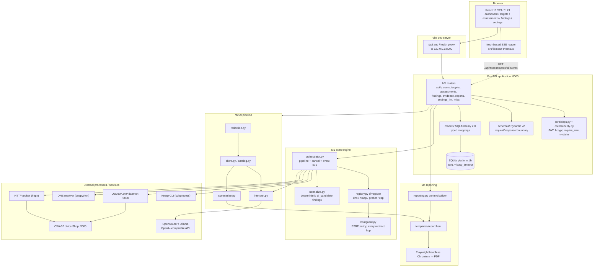
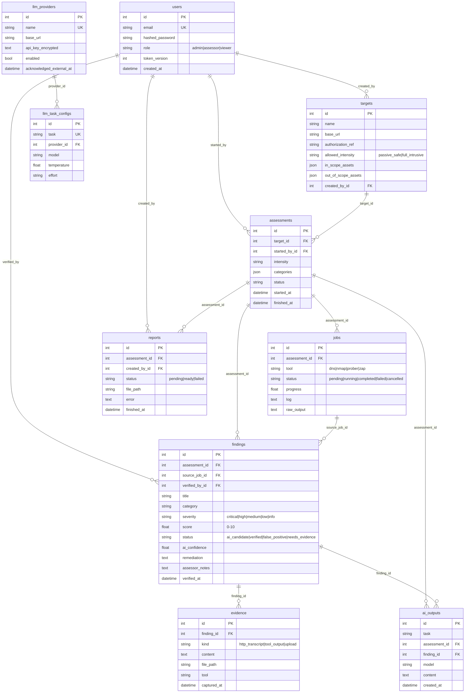
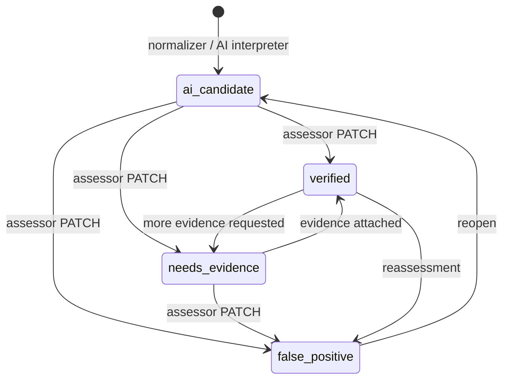

# System Design - Aletheia

**M5 task T5.2 / course milestone 2.** Status: draft assembled 2026-11-15 on branch `m5/docs-qa-deploy`.

This document describes the platform **as built**, not as originally imagined. Every diagram was checked
against the code in `backend/app/` and `frontend/src/` at commit `dff498c`. Where the shipped system differs
from the decision record, the difference is called out explicitly (§8, §9). Canonical decisions remain in
`docs/PLAN.md`; the frozen API sketches are in `docs/TASK_PLAN.md` § Wave-1 contract sketches.

---

## 1. Design goals and constraints

| Goal | Mechanism |
|---|---|
| Human assessor stays in charge | `ai_candidate` is the only entry state; verification is a role-guarded PATCH with an audit trail |
| Safe by default | Per-target `allowed_intensity` gate re-checked in the orchestrator; SSRF host guard on every redirect hop |
| No secret egress | Redaction before every LLM call; Fernet-encrypted provider keys; write-only API responses |
| Refresh-safe live runs | Jobs and assessment state persisted to SQLite; SSE sends a snapshot first, then live events |
| Fail-soft | A missing Nmap binary or unreachable ZAP daemon fails one job with an actionable log line; the assessment continues |
| Two-process deployment | uvicorn on :8000 + Vite dev server on :5173 (or built static frontend); no broker, no container |

Deliberate cut: **Celery/Redis and PostgreSQL** (`PLAN.md` §1, §12). Scan execution is an in-process
asyncio task; the cost is that a backend restart kills an in-flight run.

---

## 2. Architecture overview



**Read the diagram as three trust boundaries.** The browser never talks to a tool directly; the API never
runs an intrusive tool without the orchestrator's intensity check; no tool or scan output reaches an LLM
provider without passing through `ai/redaction.py`.

### 2.1 Component responsibilities

| Area | Files | Responsibility |
|---|---|---|
| App factory | `backend/app/main.py` | CORS (`X-Total-Count` exposed), router registration, `create_all`, additive SQLite column/index migrations, admin seeding, LLM task-config seeding |
| Config | `backend/app/config.py`, `backend/.env.example` | `SECRET_KEY`, admin bootstrap, `DATABASE_URL`, `CORS_ORIGINS`, `ZAP_API_URL`, `ZAP_API_KEY` |
| Auth | `app/api/auth.py`, `app/api/users.py`, `app/core/security.py`, `app/core/deps.py` | Login, `/me`, change-password, admin-only user CRUD, JWT with a required `tv` claim |
| Targets | `app/api/targets.py`, `app/models/target.py` | Authorized target registry, `authorization_ref`, intensity, scope lists, PATCH semantics |
| Scan engine | `app/scanner/**`, `app/api/assessments.py` | Runner registry, four tool wrappers, orchestrator, SSE event bus, cancel, normalizer |
| AI pipeline | `app/ai/**`, `app/api/settings_llm.py` | Provider CRUD (write-only keys), live model catalog, redaction, interpretation, summarization, `ai_outputs` audit |
| Findings | `app/api/findings.py`, `app/api/evidence.py`, `app/risk.py`, `app/evidence_capture.py` | Verification state machine, evidence upload/download/delete, OWASP risk mapping, `X-Total-Count` |
| Reports | `app/api/reports.py`, `app/reporting.py`, `app/templates/report.html` | 202 -> poll -> download job, eager-loaded report context, Jinja2 HTML, Playwright PDF |
| Frontend | `frontend/src/App.tsx`, `src/pages/**`, `src/lib/**`, `src/components/**` | Protected routes, TanStack Query data layer, auth-aware `api`/`apiWithMeta`/`apiBlob`, SSE reader, shadcn UI |

`frontend/src/App.tsx` registers `/`, `/targets`, `/assessments`, `/assessments/:id`, `/findings`,
`/settings` behind `ProtectedRoute`; `/login` is public. Report and finding-review UI are composed into
those pages rather than registered as separate top-level routes.

---

## 3. Entity-relationship diagram

Derived from `backend/app/models/*.py` (SQLAlchemy 2.0 typed mappings). Only key columns are shown; enums
are stored with `native_enum=False` as strings.



### 3.1 Delta from the decision record

`PLAN.md` §9 lists a separate `raw_results` table. The shipped schema does **not** have one: raw tool
output is stored on `jobs.raw_output` as JSON text, and the normalizer reads from there. The table name in
the plan also appears as `llm_task_config` (singular) while the model creates `llm_task_configs`. This
document follows the code. Neither difference changes an API shape: consumers see assessment, job and
finding schemas, never a raw-result row.

### 3.2 Storage cautions

- SQLite is opened in WAL mode with a 5 s busy timeout (`app/database.py`), and startup applies additive
  column/index migrations (`token_version`, the partial unique index for one pending report per assessment).
- **Declared foreign keys are not enforced** - there is no `PRAGMA foreign_keys=ON`. Deleting a target can
  orphan assessments, findings, jobs and reports. The UI deliberately does not offer target deletion.
  Recorded as an open defect in `AGENTS.md`; it is a data-integrity limitation, not an intended design.
- Evidence blobs and generated PDFs live under `backend/evidence/` and `backend/reports/` and are
  gitignored runtime artifacts, served only through authenticated endpoints.

---

## 4. Workflow: one assessment end to end

```mermaid
sequenceDiagram
    autonumber
    actor A as Assessor
    participant UI as React SPA
    participant API as FastAPI :8000
    participant O as Orchestrator (asyncio)
    participant T as Tools (dns/nmap/prober/zap)
    participant DB as SQLite
    participant AI as LLM (redacted)
    participant PDF as Playwright PDF

    A->>UI: Sign in (JWT with tv claim)
    UI->>API: POST /api/targets (authorization_ref, intensity)
    API-->>UI: 201 target
    A->>UI: New assessment (target, intensity, categories)
    UI->>API: POST /api/assessments
    API->>API: 409 if intensity > target.allowed_intensity
    API->>DB: create assessment + planned job rows synchronously
    API->>O: start_pipeline(assessment_id)
    API-->>UI: 201 with full run plan
    UI->>API: GET /api/assessments/id/events (authenticated fetch stream)
    API-->>UI: snapshot, then live job/progress/log events (SSE)
    O->>O: effective_intensity() re-checks target gate
    loop dns -> nmap -> prober -> (zap only at full_intrusive)
        O->>T: runner.run(job, ScanContext)
        T->>DB: log, progress, raw_output (batched commits)
        T-->>O: normalized JSON
    end
    O->>DB: normalize() writes deterministic ai_candidate findings
    O->>AI: interpret() after redaction; write AIOutput audit row (success or failure)
    AI-->>DB: additional ai_candidate findings
    O->>DB: assessment = completed; terminal SSE event
    A->>UI: Open findings page
    UI->>API: GET /api/findings (X-Total-Count)
    A->>UI: Review evidence, decide verified / false_positive / needs_evidence
    UI->>API: PATCH /api/findings/id (status compare-and-swap)
    API->>DB: 409 on overlapping decision; else verified_by/at + notes
    A->>UI: Generate report
    UI->>API: POST /api/assessments/id/report
    API-->>UI: 202 pending (idempotent: second POST returns same row)
    API->>PDF: build context from verified findings + AI summary -> HTML -> PDF
    PDF-->>DB: report = ready, file_path
    UI->>API: GET /api/reports/id (auth-aware blob)
    API-->>A: PDF download
```

Cancellation: `POST /api/assessments/{id}/cancel` sets `cancel_event`; runners poll `ctx.cancelled()`,
pending/running jobs become `cancelled` (not `failed`), and a terminal event closes the SSE stream. A
second concurrent run for the same target is rejected with 409.

### 4.1 Finding state machine

Implemented by `ALLOWED_TRANSITIONS` in `app/api/findings.py`. Any other move is a 409; viewer writes are
403. A status-changing PATCH compares-and-swaps on the status it validated, so two overlapping decisions
cannot silently overwrite each other.



Only `verified` findings feed the report's findings section. `ai_candidate` rows are visually marked in the
UI and never counted as confirmed.

---

## 5. API surface

Registered in `app/main.py`, all prefixed with `/api` except `/health`. Full shapes live in `app/schemas/`.

| Group | Endpoints |
|---|---|
| Health / auth | `GET /health`, `POST /api/auth/login`, `GET /api/auth/me`, `POST /api/auth/change-password`, `GET|POST /api/users` |
| Targets | `GET|POST /api/targets`, `GET|PATCH|DELETE /api/targets/{id}` |
| Assessments | `GET|POST /api/assessments`, `GET /api/assessments/{id}`, `GET /api/assessments/{id}/events` (SSE), `POST /api/assessments/{id}/cancel` |
| Findings | `GET /api/findings` (bounded `limit`/`offset` + `X-Total-Count`), `GET|PATCH /api/findings/{id}` |
| Evidence | `GET|POST /api/findings/{id}/evidence`, `GET /api/evidence/{id}/download`, `DELETE /api/evidence/{id}` |
| Reports | `POST /api/assessments/{id}/report` (202), `GET /api/assessments/{id}/reports`, `GET /api/reports/{id}`, `DELETE /api/reports/{id}` |
| LLM settings | `GET /api/settings/llm`, `POST /api/settings/llm/providers`, `PUT|DELETE /api/settings/llm/providers/{id}`, `GET /api/settings/llm/providers/{id}/models`, `PUT /api/settings/llm/tasks/{task}`, `POST /api/settings/llm/test` |

Error convention: FastAPI `detail` strings; **403** for role violations, **409** for illegal transitions,
intensity-gate violations, concurrent runs and overlapping decisions, **422** for validation (e.g.
`limit > 500`). The endpoint x role matrix is in `docs/auth-checklist.md` (M4); note that document predates
the `PUT -> PATCH` target change and the newer evidence/report DELETE routes, so re-check it before the oral
defense.

---

## 6. Security design

| Control | Implementation | Enforcement point |
|---|---|---|
| Authentication | JWT (HS256) with `exp`, `sub`, `tv`; bcrypt password hashes | `core/security.py`, `core/deps.py` |
| Session revocation | `users.token_version` bumped on password change; older tokens get 401 | `api/auth.py`, proposal 09 |
| Authorization | `require_role(admin, assessor, viewer)`; viewer is read-only | Every router; audited in `docs/auth-checklist.md` |
| Scope gate | `target.allowed_intensity` checked at assessment create **and** at scheduling | `api/assessments.py` (409), `orchestrator.effective_intensity()` |
| SSRF / host policy | Private/loopback allowed only with `authorization_ref` + in-scope asset; cloud metadata blocked; every httpx redirect hop revalidated | `scanner/hostguard.py` |
| Secret egress | Regex + deny-list redaction of credentials, tokens, keys and provider error bodies | `ai/redaction.py`, before every LLM call |
| Secrets at rest | Fernet-encrypted `api_key_encrypted`; keys never returned, never logged | `models/llm.py`, `api/settings_llm.py` |
| Human verification | `ai_candidate` is the only insertion state; role-guarded state machine + CAS | `api/findings.py` |
| File safety | Uploads capped, stored outside the web root, served only via authenticated download | `api/evidence.py` |
| Discretion gate | Changing a provider `base_url` or key re-requires an acknowledgement before external calls | `api/settings_llm.py`, proposal 07 |

**Hard rules (never weaken):** human verification, intensity gate, authorized targets only, secret
redaction. These are the fixed side of the negotiation table in `TASK_PLAN.md`.

---

## 7. Deployment topology (native Windows, development)

| Process | Port | Started by | Notes |
|---|---|---|---|
| uvicorn `app.main:app` | 8000 | `scripts/setup-dev.ps1` instructions / README | Serves REST + SSE + generated PDFs |
| Vite dev server | 5173 | `npm run dev` | Proxies `/api` and `/health` to 8000 |
| OWASP Juice Shop | 3000 | `npm start` in a separate clone | Authorized demo target |
| ZAP daemon | 8080 | `zap.bat -cmd -daemon -port 8080 -config api.key=<secret>` | Only needed for `full_intrusive` runs |
| Nmap | n/a (CLI) | subprocess by `nmap_runner.py` | Must be on `PATH` |
| Playwright Chromium | n/a | `python -m playwright install chromium` | PDF rendering only |

Environment variables are read from `backend/.env` (gitignored), scaffolded from `backend/.env.example`.
Default dev login is `admin@example.com` / `admin123`, which must be changed before any non-local use.

---

## 8. Known limitations (honest list)

From `AGENTS.md` "Known integration blockers" and `docs/auth-checklist.md`, restated here so the design
document agrees with the status snapshot:

1. **Tool installs pending (M5 T5.1).** Nmap, the ZAP daemon and Playwright Chromium are not installed in
   the development environment. `dns`/`prober` work, `nmap` fails soft, and PDF generation errors with an
   actionable message. These are environment tasks, not code defects.
2. **AI needs a real provider key.** The OpenRouter row is disabled with no key, so scans complete on the
   rule-based normalizer and skip interpretation cleanly (`NoProviderConfigured`). Placeholder keys are
   rejected at save time.
3. **SQLite FKs unenforced.** See §3.2. Target deletion is not offered in the UI.
4. **No login rate limiting**, no 2FA, no per-token revocation list; JWT lifetime (12 h) is the bound.
5. **Single-process worker.** A backend restart kills in-flight runs; jobs persist but the assessment stays
   `running` until re-launched.
6. **No frontend automated test harness.** Verification is `npm run build`, `npm run lint` and manual
   browser passes in both themes. The Wave 4 dashboard visual pass is still outstanding because Chromium
   is missing.
7. **Evidence binary download from the detail drawer** is not wired; the UI shows uploaded file metadata.
8. **Doc drift.** `docs/auth-checklist.md` still says `PUT /api/targets/{id}` and omits the newer DELETE
   routes; it is M4-owned and must be refreshed by its owner, not rewritten by M5.

---

## 9. Traceability

| Design element | Decision source | Code | Verified by |
|---|---|---|---|
| Stack, runtime, cuts | `PLAN.md` §1, §12 | `requirements.txt`, `frontend/package.json` | build + boot |
| Pipeline order and intensity | `PLAN.md` §2, §7; `TASK_PLAN.md` T1.6 | `scanner/orchestrator.py` | `tests/test_orchestrator_state.py` |
| Frozen contracts | `TASK_PLAN.md` § Wave-1 | `app/schemas/**`, `frontend/src/lib/types.ts` | API smoke tests |
| Verification state machine | `PLAN.md` §6; `TASK_PLAN.md` T4.1 | `app/api/findings.py` | `tests/test_findings_api.py`, `test_w5_concurrency.py` |
| Risk mapping | `docs/risk-methodology.md` | `app/risk.py` | `tests/test_risk_model.py` |
| Report pipeline | `TASK_PLAN.md` T4.4 | `app/reporting.py`, `app/templates/report.html` | `tests/test_reports_api.py`, `test_w5_report_context.py` |
| Redaction / encrypted keys | `PLAN.md` §5 | `app/ai/redaction.py`, `models/llm.py` | `tests/test_redaction.py`, `test_settings_llm.py` |
| Integration waves | `TASK_PLAN.md` §9 | `docs/INTEGRATION_LOG.md` | live rehearsal (pending) |
